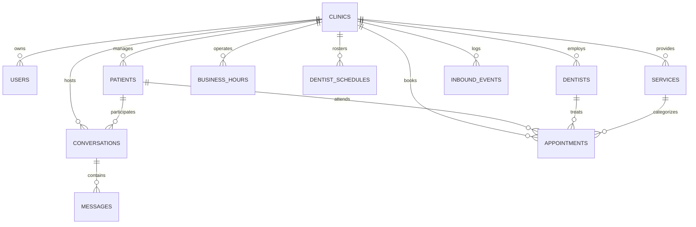

# Dental AI Receptionist — Database Multi-Tenant Architecture & Data Integrity Model

## 1. Multi-Tenant Philosophy

In the Dental AI Receptionist architecture, each clinic is an autonomous medical tenant. A patient may visit multiple clinics and may have the same legal name and mobile phone number registered at each clinic. Under healthcare data privacy principles:
- **No Shared Medical Records Across Clinics**: Each clinic retains its own isolated patient chart, visit history, procedure notes, and communication logs.
- **Clinic-Scoped Identity**: Phone numbers and WhatsApp IDs are unique **only within the scope of a single clinic** (`@@unique([clinic_id, whatsapp_id])`), never globally unique across the entire platform.
- **Tenant Authorization at the Data Layer**: A `clinic_id` provided in client request bodies or query parameters is never trusted. Every database query, mutation, and procedure derives tenant scope from server-side cryptographic authentication or verified integration identity.

---

## 2. Entity Relational Hierarchy



---

## 3. Authoritative Schema & Tenant Constraints (`schema: api`)

### 3.1 `api.clinics` (Root Tenant Entity)
- **Primary Key**: `id UUID DEFAULT gen_random_uuid()`
- **Key Columns**:
  - `name TEXT NOT NULL`
  - `slug TEXT NOT NULL UNIQUE`
  - `timezone TEXT NOT NULL` (IANA timezone, e.g. `America/New_York`)
  - `locale TEXT DEFAULT 'en-US'`
  - `active BOOLEAN DEFAULT true`
  - `suspended_at TIMESTAMPTZ NULL`
  - `settings JSONB DEFAULT '{}'` (receptionist preferences, Meta WhatsApp credentials, business configuration)

### 3.2 `api.users` (Staff & Administrative Users)
- **Primary Key**: `id UUID DEFAULT gen_random_uuid()`
- **Foreign Key**: `clinic_id UUID REFERENCES api.clinics(id) ON DELETE CASCADE`
- **Key Constraints**:
  - `auth_subject TEXT NOT NULL UNIQUE` (stores bcrypt hash `$2a$...` or external ID)
  - `role TEXT NOT NULL`
  - `CHECK (role = ANY (ARRAY['owner'::text, 'admin'::text, 'staff'::text, 'dentist'::text, 'readonly'::text]))`
  - `active BOOLEAN DEFAULT true`
- **Index**: `@@index([clinic_id], map: "users_clinic_idx")`

### 3.3 `api.patients` (Clinic-Scoped Patient Charts)
- **Primary Key**: `id UUID DEFAULT gen_random_uuid()`
- **Foreign Key**: `clinic_id UUID REFERENCES api.clinics(id) ON DELETE CASCADE`
- **Multi-Tenant Constraint**:
  - `@@unique([clinic_id, whatsapp_id])`
  - *Critical*: Phone number is NOT globally unique. Two clinics can have the same patient phone number with separate medical charts.
- **Index**: `@@index([clinic_id], map: "patients_clinic_idx")`

### 3.4 `api.conversations` (Patient Communication Channels)
- **Primary Key**: `id UUID DEFAULT gen_random_uuid()`
- **Foreign Key**: `clinic_id UUID REFERENCES api.clinics(id) ON DELETE CASCADE`
- **Foreign Key**: `patient_id UUID REFERENCES api.patients(id) ON DELETE SET NULL`
- **Multi-Tenant Constraint**:
  - `@@unique([clinic_id, channel, channel_conversation_id])`
  - Guarantees that conversations on the same channel (WhatsApp, web chat) with the same phone number in two different clinics remain completely isolated.
- **Indexes**: `@@index([clinic_id])`, `@@index([patient_id])`

### 3.5 `api.messages` (Conversation Message Logs)
- **Primary Key**: `id UUID DEFAULT gen_random_uuid()`
- **Foreign Key**: `clinic_id UUID REFERENCES api.clinics(id) ON DELETE CASCADE`
- **Foreign Key**: `conversation_id UUID REFERENCES api.conversations(id) ON DELETE CASCADE`
- **Constraint**: `@@unique([conversation_id, provider_message_id])` (prevents duplicate message insertion on webhook replays)
- **Indexes**: `@@index([clinic_id])`, `@@index([conversation_id])`, `@@index([created_at])`

### 3.6 `api.appointments` (Clinical Booking Records)
- **Primary Key**: `id UUID DEFAULT gen_random_uuid()`
- **Foreign Keys**:
  - `clinic_id UUID REFERENCES api.clinics(id) ON DELETE CASCADE`
  - `dentist_id UUID REFERENCES api.dentists(id)`
  - `patient_id UUID REFERENCES api.patients(id)`
  - `service_id UUID REFERENCES api.services(id)`
- **Key Constraints**:
  - `confirmation_code TEXT NOT NULL UNIQUE` (e.g. `DZXV-CUIN`)
  - Exclusion constraint on `(dentist_id, tstzrange(starts_at, ends_at))` preventing double booking of practitioners.
- **Timestamps**: All timestamps (`starts_at`, `ends_at`) stored in UTC with timezone (`timestamptz`).
- **Indexes**: `@@index([clinic_id])`, `@@index([dentist_id, starts_at])`, `@@index([patient_id])`, `@@index([status])`

### 3.7 `api.inbound_events` (Webhook Idempotency Journal)
- **Primary Key**: `id UUID DEFAULT gen_random_uuid()`
- **Foreign Key**: `clinic_id UUID REFERENCES api.clinics(id) ON DELETE CASCADE`
- **Idempotency Constraint**:
  - `@@unique([clinic_id, provider_event_id])`
  - Ensures at-least-once webhook delivery does not result in duplicate appointment bookings.

---

## 4. Query-Level Isolation Standards

Every repository function and SQL query must satisfy these criteria:

1. **Mandatory Tenant Clause**:
   ```sql
   -- Standard pattern across all reads and writes:
   SELECT ... FROM api.entity_name
   WHERE id = $1::uuid AND clinic_id = $2::uuid
   ```
2. **Denial on Mismatch**:
   If a record exists with the requested `id` but belongs to a different `clinic_id`, queries return empty results (`404 NOT_FOUND`), or trigger `assertClinicOwnership(req, recordClinicId)` throwing `ForbiddenError`.
3. **No Cross-Clinic Joins Without Explicit Admin Context**:
   Joins between `api.patients` and `api.conversations` must enforce:
   ```sql
   JOIN api.patients p ON p.id = c.patient_id AND p.clinic_id = c.clinic_id
   ```

---

## 5. Contact Name Resolution Priority Order

When displaying chat conversations in the reception module, patient names are resolved using this authoritative hierarchy:

```
1. Verified Patient Chart Name (p.full_name where p.clinic_id = c.clinic_id)
      ↓ (if absent or empty)
2. Verified Patient Phone Number (p.phone)
      ↓ (if unlinked in patient chart)
3. Channel Conversation ID if numeric (c.channel_conversation_id)
      ↓ (if non-numeric or empty)
4. Fallback: "Unknown contact"
```
*Under no circumstances is a generic string such as "WhatsApp user" or "WhatsApp Patient" emitted.*

---

## 6. Migration and Backfill Guidelines

- **Additive Changes Only**: New columns or tables must be additive with safe defaults.
- **Preserve Existing Records**: Never drop tables, reset schemas, or delete appointment records during migrations.
- **Zero Data Contamination**: Test suites and integration tests must run against isolated test fixtures or clean up temporary test clinics immediately upon test completion.
