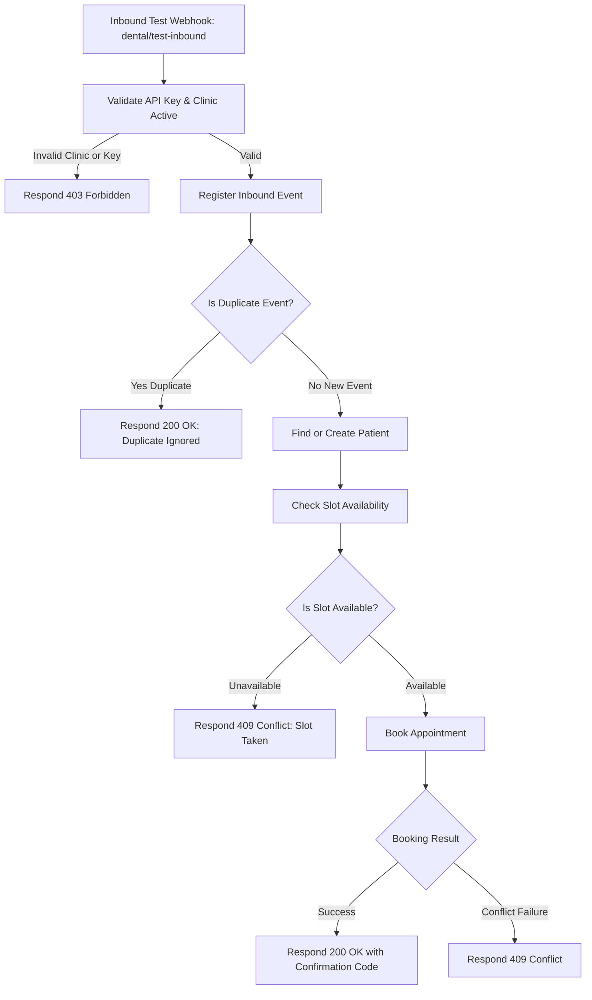

# Dental AI Receptionist — Authoritative n8n Integration Contract

## 1. Overview & Architectural Boundaries

This document defines the authoritative API and database contracts between **n8n workflow automation** and the **Dental AI Receptionist application & database**.

### Fundamental Rules:
1. **No Changes to Production n8n Workflows Yet**: This contract stabilizes the application and database side first. The subsequent n8n prompt will implement the workflow updates according to these verified specifications.
2. **Preserve Meta/WhatsApp Webhook Integrity**: The production Meta webhook endpoint (`/webhook/meta` or `/api/v1/webhook/whatsapp`) and its HMAC-SHA256 signature verification MUST remain completely intact. Non-Meta requests must never be routed through Meta-specific phone number ID resolution.
3. **Multi-Tenant Safety**: n8n must never process requests across clinics or trust unauthenticated clinic identifiers. Every request must be authenticated and mapped to a verified clinic.
4. **Authoritative Timestamp Standard**: All instants in transport and storage are ISO 8601 UTC strings (`YYYY-MM-DDTHH:mm:ss.sssZ`). Clinic wall-clock presentations and booking slot inputs are interpreted using the clinic's configured IANA timezone (e.g., `America/New_York`).

---

## 2. Inbound Webhook Classification & Authentication

| Endpoint | Ingestion Type | Auth Mechanism | Clinic Resolution Mechanism | Intended Caller |
|---|---|---|---|---|
| `GET /webhook/meta` | Public Challenge | `hub.verify_token` | Query parameter matching clinic setting | Meta Cloud Platform |
| `POST /webhook/meta` | Inbound WhatsApp | HMAC-SHA256 (`x-hub-signature-256`) | Payload `entry[0].changes[0].value.metadata.phone_number_id` -> `api.clinics.settings.meta_phone_number_id` | Meta Cloud Platform |
| `POST /dental/test-inbound` (or `/api/v1/n8n/booking-test`) | Test / Integration Webhook | Header Auth (`x-api-key`) | Header `x-clinic-id` or API Key mapping verified against `api.clinics` | n8n Cloud / Testing Suite |
| `POST /api/v1/appointments` | Application API | JWT Bearer Token | `req.user.clinicId` extracted from cryptographically verified token | Authenticated Clinic Users / Dashboard |

---

## 3. Authoritative PostgreSQL Stored Functions for n8n

The application database includes authoritative PostgreSQL stored procedures in schema `api` that execute atomic transactional booking workflows with conflict prevention and idempotency.

### 3.1 `api.register_inbound_event`
Registers an inbound webhook event idempotently. If the event was already processed, it prevents duplicate booking or patient creation.

- **Signature**:
  ```sql
  api.register_inbound_event(
    p_clinic_id UUID,
    p_provider TEXT,
    p_provider_event_id TEXT,
    p_payload JSONB
  ) RETURNS JSONB
  ```
- **Inputs**:
  - `p_clinic_id`: Valid clinic UUID.
  - `p_provider`: Channel provider name (e.g. `'whatsapp'`, `'test'`, `'web'`).
  - `p_provider_event_id`: External message ID (e.g. `wamid.HBg...` or test idempotency key).
  - `p_payload`: Raw JSON payload.
- **Return JSON Structure**:
  ```json
  {
    "ok": true,
    "code": "OK",
    "message": "Event registered",
    "data": {
      "id": "uuid-of-event",
      "duplicate": false
    }
  }
  ```
  If `duplicate: true`, n8n must stop execution immediately and return HTTP 200 without creating duplicate appointments.

---

### 3.2 `api.find_or_create_patient`
Resolves or creates a clinic-scoped patient record.

- **Signature**:
  ```sql
  api.find_or_create_patient(
    p_clinic_id UUID,
    p_phone TEXT,
    p_full_name TEXT
  ) RETURNS JSONB
  ```
  *(Note: Signature accepts 3 parameters: `clinic_id`, `phone`, `full_name`. An optional 6-parameter overload is also supported with email, address, metadata).*
- **Inputs**:
  - `p_clinic_id`: Clinic UUID.
  - `p_phone`: Normalized E.164 phone number (e.g. `+15551234567`).
  - `p_full_name`: Real patient name (e.g. `Rahul Sharma`).
- **Return JSON Structure**:
  ```json
  {
    "ok": true,
    "code": "OK",
    "message": "Patient found or created",
    "data": {
      "id": "patient-uuid",
      "fullName": "Rahul Sharma",
      "phone": "+15551234567",
      "created": false
    }
  }
  ```
  *Field Mapping Note: The returned patient ID is available at `$json.result.data.id` or `$json.data.id`.*

---

### 3.3 `api.search_availability`
Checks dentist and clinic availability for a requested date and procedure.

- **Signature**:
  ```sql
  api.search_availability(
    p_clinic_id UUID,
    p_dentist_id UUID,
    p_service_id UUID,
    p_date DATE
  ) RETURNS JSONB
  ```
- **Inputs**:
  - `p_clinic_id`: Clinic UUID.
  - `p_dentist_id`: Dentist UUID.
  - `p_service_id`: Procedure UUID.
  - `p_date`: Clinic-local date (`YYYY-MM-DD`).
- **Return JSON Structure**:
  ```json
  {
    "ok": true,
    "code": "OK",
    "message": "Availability computed",
    "data": {
      "date": "2026-10-15",
      "timezone": "America/New_York",
      "slots": [
        {
          "startsAt": "2026-10-15T14:00:00.000Z",
          "endsAt": "2026-10-15T14:45:00.000Z",
          "localTime": "10:00 AM",
          "available": true
        }
      ]
    }
  }
  ```

---

### 3.4 `api.book_appointment`
Atomically books an appointment with PostgreSQL GiST exclusion constraint conflict prevention.

- **Signature**:
  ```sql
  api.book_appointment(
    p_clinic_id UUID,
    p_dentist_id UUID,
    p_patient_id UUID,
    p_service_id UUID,
    p_starts_at TIMESTAMPTZ,
    p_notes TEXT DEFAULT NULL,
    p_metadata JSONB DEFAULT '{}'::jsonb
  ) RETURNS JSONB
  ```
- **Inputs**:
  - `p_clinic_id`: Clinic UUID.
  - `p_dentist_id`: Dentist UUID.
  - `p_patient_id`: Patient UUID.
  - `p_service_id`: Service UUID.
  - `p_starts_at`: Exact UTC timestamp (`2026-10-15T14:00:00.000Z`).
  - `p_notes`: Booking notes.
- **Success Return (HTTP 200 / 201)**:
  ```json
  {
    "ok": true,
    "code": "OK",
    "message": "Appointment booked successfully",
    "data": {
      "id": "appointment-uuid",
      "confirmationCode": "ABCD-1234",
      "startsAt": "2026-10-15T14:00:00.000Z",
      "endsAt": "2026-10-15T14:45:00.000Z",
      "status": "confirmed"
    }
  }
  ```
- **Conflict Return (HTTP 409 Conflict)**:
  ```json
  {
    "ok": false,
    "code": "CONFLICT",
    "message": "The requested time slot is no longer available. Please select another time.",
    "data": null
  }
  ```

---

## 4. HTTP Status Code Mapping for n8n Webhook Responses

| Workflow Condition | HTTP Status | Response Payload | n8n Action |
|---|---|---|---|
| Invalid or missing API key | **401 Unauthorized** | `{"ok": false, "code": "UNAUTHORIZED", "message": "Authentication required"}` | Terminate workflow |
| Invalid or unknown clinic | **403 Forbidden** | `{"ok": false, "code": "FORBIDDEN", "message": "Clinic not authorized"}` | Terminate workflow |
| Duplicate inbound event | **200 OK** | `{"ok": true, "code": "OK", "message": "Event already processed", "data": {"duplicate": true}}` | Return immediately without booking |
| Requested slot unavailable / double booking | **409 Conflict** | `{"ok": false, "code": "CONFLICT", "message": "Time slot unavailable"}` | Notify conversational agent to offer alternate slot |
| Validation failure (bad date, invalid UUID) | **422 Unprocessable** | `{"ok": false, "code": "VALIDATION", "message": "Invalid input format"}` | Non-retryable error |
| Booking successful | **200 OK** | `{"ok": true, "code": "OK", "message": "Appointment booked", "data": {...}}` | Send confirmation to patient |

---

## 5. Required n8n Workflow Graph Structure



---

## 6. Security & Credential Rules for n8n
- **Never Hardcode Secrets in Workflow Expressions**: All API keys, database credentials, and WhatsApp tokens must reference n8n Credentials or Environment Variables.
- **Clinic Scope Guarantee**: n8n must never pass `$json.body.clinic_id` directly without verifying against the authenticated clinic associated with the API key or phone number ID.
