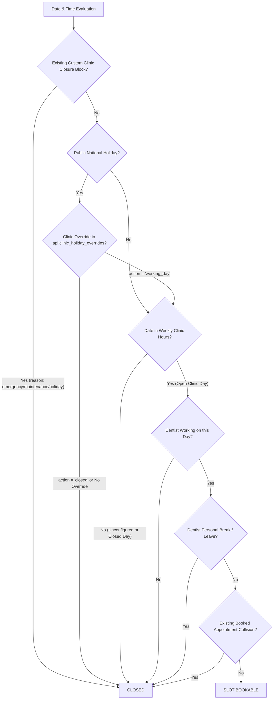

# Scheduling, Availability Engine, and Holiday Rules

## 1. Operating Hours & Initial Clinic State

### A. Unconfigured State (Zero Default Assumption)
- Newly registered clinics start with **zero** rows in `api.business_hours`.
- An unconfigured schedule is treated by the scheduling and availability engines as **strictly closed**.
- **Saturday and Sunday are NEVER open by default**:
  - The legacy behavior of assuming Monday–Friday 09:00–17:00 and Saturday 09:00–14:00 has been eliminated.
  - No bookable slots are produced until the clinic administrator explicitly configures hours in **Dentists & Hours** and clicks **Save Schedule**.
- When an administrator configures their hours, any weekday marked closed or omitted has no row in `api.business_hours`.

### B. Independent Dentist Schedules
- Clinic operating hours define the facility envelope (when the building is open).
- Individual dentist hours (`api.dentist_working_hours`) define practitioner shifts.
- Both must intersect for an appointment slot to be bookable:
  $$\text{Slot Available} \iff \text{Time} \in \text{ClinicHours} \land \text{Time} \in \text{DentistHours}$$
- If a dentist has no custom shift configured for a day, the scheduling engine falls back to standard clinic hours for that dentist only if clinic hours exist.
- Dentist lunch breaks and leave (`api.schedule_blocks` with `dentist_id`) take precedence over regular shifts.

---

## 2. Location-Aware Public Holiday Rules

### A. Jurisdiction Auto-Resolution
- Public holidays are determined based on the clinic's configured `country` in `api.clinics.settings->country`.
- Supported Jurisdictions:
  - `US` (United States): New Year's Day, Martin Luther King Jr. Day, Washington's Birthday, Memorial Day, Juneteenth, Independence Day, Labor Day, Columbus Day, Veterans Day, Thanksgiving, Christmas Day.
  - `GB` (United Kingdom): New Year's Day, Good Friday, Easter Monday, Early May Bank Holiday, Spring Bank Holiday, Summer Bank Holiday, Christmas Day, Boxing Day.
  - `CA` (Canada): New Year's Day, Good Friday, Victoria Day, Canada Day, Labour Day, National Day for Truth and Reconciliation, Thanksgiving, Remembrance Day, Christmas Day.
  - `AU` (Australia): New Year's Day, Australia Day, Good Friday, Easter Monday, Anzac Day, King's Birthday, Christmas Day, Boxing Day.
  - `IN` (India): Republic Day, Independence Day, Gandhi Jayanti, Diwali, Christmas Day, and major gazetted holidays.
- Fallback: If no country is specified in settings, it falls back to `US` until configured.

### B. Precedence Architecture & Pre-Calculated Schedules
When calculating whether a date is open for appointments, the availability engine evaluates rules in strict hierarchical order:

### Precedence Hierarchy:
1. **Whole-Clinic Schedule Block / Emergency Closure** (`api.schedule_blocks` where `dentist_id IS NULL`): Highest priority closure.
2. **Clinic-Specific Holiday Override** (`api.clinic_holiday_overrides`):
   - If `action = 'working_day'`, the public holiday is treated as an open working day conforming to the regular weekly clinic hours.
   - If `action = 'closed'`, the day is closed regardless of standard weekly hours.
3. **Default National Public Holiday**: Defaults to closed if no override exists.
4. **Standard Weekly Clinic Operating Hours** (`api.business_hours`).
5. **Dentist Individual Shift** (`api.dentist_working_hours`).
6. **Dentist Break or Leave Block** (`api.schedule_blocks` where `dentist_id` matches).
7. **Existing Confirmed Appointment & Buffer Window** (`api.appointments`).

---

## 3. Timezone Semantics & Conflict Handling

### Local Time vs UTC Conversion
- In `api.business_hours`, times are stored in local clinic time (`HH:MM:SS`) because business hours recur weekly according to local clocks, immune to daylight saving shifts.
- In `api.appointments` and `api.schedule_blocks`, timestamps are stored as `timestamptz` in **UTC**.
- When generating availability, local day intervals (e.g. `2026-06-15 09:00 to 17:00 America/Chicago`) are converted to absolute UTC intervals (`2026-06-15T14:00:00Z to 2026-06-15T22:00:00Z`).
- This guarantees accurate booking across daylight saving transitions (DST spring-forward and fall-back).

### Non-Destructive Closure Creation
- Adding a holiday override or closure block **never deletes or cancels existing appointments** automatically.
- Any conflicting appointments are detected and returned in the UI conflict warning modal (`blockConflicts`), allowing clinic staff to reschedule patients gracefully rather than silently dropping bookings.
