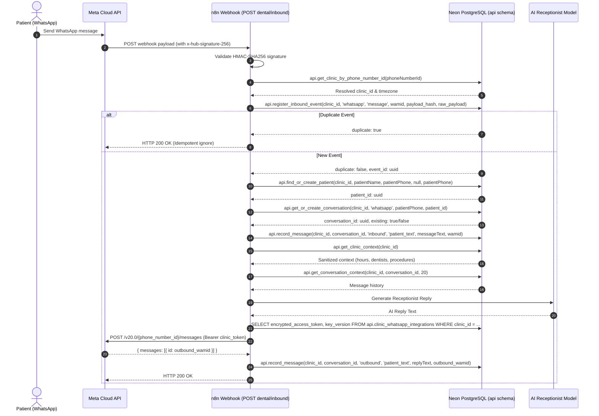

# WhatsApp Integration Contract: Meta Cloud API & n8n Production Architecture

**Version**: 2.0.0 (Multi-Tenant Secure Edition)  
**Date**: October 19, 2026  
**Status**: Authoritative Integration Specification  

---

## 1. Webhook Ingestion & Meta Handshake

The production n8n workflow must host two webhook paths on n8n Cloud:

### A. Webhook Verification (`GET dental/inbound`)
- **Query Parameters Sent by Meta**:
  - `hub.mode`: `'subscribe'`
  - `hub.verify_token`: Platform-configured verification token
  - `hub.challenge`: Integer string challenge
- **n8n Behavior**:
  - Validates `hub.verify_token === $env.META_WEBHOOK_VERIFY_TOKEN`.
  - If valid, responds HTTP 200 with raw text body `$json.query['hub.challenge']`.
  - If invalid, responds HTTP 403 Forbidden.

### B. Inbound Event Processing (`POST dental/inbound`)
- **Headers**:
  - `x-hub-signature-256`: `sha256=<hmac_hex>`
- **Signature Validation**:
  - Computes `HMAC-SHA256` of the **raw, unparsed request body** using `$env.META_APP_SECRET`.
  - Uses timing-safe string comparison between computed signature and `x-hub-signature-256`.
  - If signature mismatch, responds HTTP 401/403 and halts immediately.
- **Fast Webhook Acknowledgment**:
  - Meta requires webhook acknowledgment within 15–20 seconds to prevent automated retry storms.
  - Recommended pattern: n8n responds HTTP 200 OK immediately after registering the event in `api.inbound_events`, then executes AI generation and outbound dispatch asynchronously.

---

## 2. Inbound Payload Extraction & Clinic Resolution

### A. Meta JSON Extraction
```javascript
// Incoming message payload path
const entry = $json.body?.entry?.[0];
const change = entry?.changes?.[0]?.value;

const phoneNumberId = change?.metadata?.phone_number_id; // Receiving clinic's WABA phone ID
const message = change?.messages?.[0];
const patientPhone = message?.from;                      // Patient WhatsApp E.164 number
const providerMessageId = message?.id;                   // Meta wamid: wamid.HBg...
const messageText = message?.text?.body;                 // Patient message body
```

### B. Tenant Clinic Resolution
Execute PostgreSQL query against schema `api`:
```sql
SELECT api.get_clinic_by_phone_number_id($1) as resolution;
-- Parameter: phoneNumberId
```

**Resolution Responses**:
1. **`ok: true, code: 'OK'`**:
   ```json
   {
     "clinic_id": "00000000-0000-0000-0000-000000000001",
     "name": "Demo Dental Clinic",
     "slug": "demo",
     "timezone": "America/New_York",
     "phone_number_id": "1330570960147204",
     "integration_status": "valid"
   }
   ```
2. **`ok: false, code: 'NOT_FOUND'`**:
   - Unknown Phone Number ID.
   - Halt workflow and log warning. Do NOT process under demo clinic.
3. **`ok: false, code: 'INACTIVE'` or `'SUSPENDED'`**:
   - Clinic is deactivated or suspended.
   - Halt workflow immediately; do NOT invoke LLM or execute bookings.
4. **`ok: false, code: 'AMBIGUOUS_MAPPING'`**:
   - Ambiguous routing detected. Halt workflow safely.

---

## 3. Storage Engine Workflow Execution

All subsequent database operations must supply the resolved `clinic_id` as the tenant guard.



---

## 4. Multi-Tenant Outbound Credentials

### Outbound Rule
- n8n must **never** use a single global Meta access token credential across all clinics.
- For genuine multi-tenancy, the HTTP Request node for Meta Cloud API must evaluate dynamic headers:
  - **URL**: `https://graph.facebook.com/v20.0/{{ $json.phone_number_id }}/messages`
  - **Header**: `Authorization: Bearer {{ $json.decrypted_access_token }}`
  - **Body**:
    ```json
    {
      "messaging_product": "whatsapp",
      "recipient_type": "individual",
      "to": "{{ $json.patient_phone }}",
      "type": "text",
      "text": {
        "preview_url": false,
        "body": "{{ $json.ai_reply }}"
      }
    }
    ```

---

## 5. Security & Isolation Invariants

1. **No Token Exposure in Clinic Context**: `api.get_clinic_context` strips all secret tokens. n8n must not look for the token in the AI context block.
2. **Strict Thread Continuity**: `api.get_or_create_conversation` ensures subsequent messages from the same phone number attach to the existing open conversation for that clinic.
3. **Database GiST Exclusion**: Booking collisions are trapped at the database engine level via `appointments_no_overlap_active`.
4. **Idempotent Inbound Deduplication**: Meta webhook retries with the same `wamid` return `duplicate: true`, preventing multiple replies or bookings.
